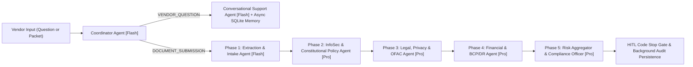

# Vendor Risk & Compliance Multi-Agent System

An enterprise **Third-Party Risk Management (TPRM) & Vendor Onboarding** multi-agent platform built with **Python, FastAPI, LangGraph StateGraph, Native LLM Tool Calling (`Google Gemini` & `OpenAI`), Explicit JSON Schemas, Non-Blocking Async/Background SQLite Memory, `structlog` + OpenTelemetry Distributed Tracing, and Terraform/Kubernetes/Docker Infrastructure as Code (IaC)**.

---

## Architecture & Rubric Alignment



### Key Capabilities

1. **Orchestration, Strategic Model Routing & HITL Code Stop (`app/orchestrator.py`, `app/llm_client.py`)**
   - **Intent-Driven Multi-Agent Patterns**: Coordinator Agent classifies vendor input via `IntentClassificationStructuredSchema` into either the **Conversational Pattern** (Flash Support Agent + Persistent Session Memory) or the **Sequential Pattern** (Extraction $\rightarrow$ Constitutional Policy Check $\rightarrow$ HITL Gate).
   - **Strategic Model Routing**: Routes low-latency agents (`coordinator`, `support`, `intake`) to **Flash** (`gemini-2.5-flash` / `gpt-4o-mini`) and complex reasoning agents (`policy_checker`, `infosec`, `legal`, `financial`, `compliance_officer`) to **Pro** (`gemini-2.5-pro` / `gpt-4o`).
   - **Human-in-the-Loop (HITL) Code Stop**: Automatically halts execution with `PAUSED_REQUIRING_HUMAN_APPROVAL` when a vendor is flagged as `HIGH` or `CRITICAL` risk.

2. **Non-Blocking Async & Background Task Memory (`app/memory_store.py`)**
   - **Async Coroutines**: Provides `aget_session`, `aupsert_session`, `aappend_conversation_turn`, and `alist_all_sessions` powered by `aiosqlite` / `asyncio.to_thread` and SQLite Write-Ahead Logging (`PRAGMA journal_mode=WAL`).
   - **Background Persistence Offloading**: Uses FastAPI `BackgroundTasks`, `asyncio.Task`, and a background `ThreadPoolExecutor` (`schedule_background_upsert`, `schedule_background_conversation_turn`) paired with a write-through in-memory session cache so memory writes never block request handling.

3. **Explicit Tool Docstrings, Strict JSON Schemas & Native LLM Tool Calling (`app/tools.py`, `app/models.py`)**
   - **Google-Style Docstrings**: Every tool function in `app/tools.py` documents explicit `Args:`, `Returns:`, and `Raises:` parameter specifications.
   - **Strict JSON Schemas**: Defines `TOOL_JSON_SCHEMAS`, `get_openai_tool_schemas()` (`strict: True`, `additionalProperties: False`), and `get_gemini_tool_declarations()` alongside Pydantic input/output models (`ExtractCertificationsToolArgs`, `ClassifyCriticalityToolArgs`, `EvaluateInfoSecToolArgs`, `EvaluateLegalSanctionsToolArgs`, `EvaluateFinancialOpsToolArgs`, and `AgentStructuredSynthesisSchema`).
   - **Native LLM Tool Calling**: `HybridLLMClient.execute_agent_with_tools()` binds tool declarations to Gemini (`types.Tool(function_declarations=...)`) and OpenAI (`tools=[...]`), validates LLM tool call arguments via `validate_tool_arguments_against_schema()`, dispatches via `execute_registered_tool()`, and constrains outputs with `response_schema` / `response_format`.
   - **Guided Error Recovery**: `extract_vendor_security_certifications` returns actionable recovery guidance for encrypted PDFs, OCR-corrupted scans, and expired audit reports.

4. **Structured Logging (`structlog`), OpenTelemetry Tracing & Active PII Redaction (`app/observability.py`)**
   - **Dedicated Structured Logging**: Uses `structlog` (and `StructuredJSONFormatter`) with ISO-8601 timestamps, log levels, OpenTelemetry trace context injection, and automated PII scrubbing.
   - **OpenTelemetry Distributed Tracing**: Configures `TracerProvider`, `SimpleSpanProcessor`, `RedactingInMemorySpanExporter`, and `OTLPSpanExporter` with W3C `trace_id` and `span_id` propagation across root pipeline spans (`vendor_onboarding.pipeline`), child agent spans (`agent.*`), and child tool spans (`tool.*`).
   - **Active PII Redaction**: Scrubs emails, phone numbers, SSNs/EINs, API keys (`sk-*`, `AIza*`), and contact names before logs or span attributes are persisted or exported.

5. **Security-Hardened Secrets & Infrastructure as Code (`app/config.py`, `infra/`, `Dockerfile`, `docker-compose.yml`)**
   - **Masked `SecretStr` Credentials**: `app/config.py` wraps API keys in Pydantic `SecretStr` and supports Kubernetes/Docker mounted secret files (`GEMINI_API_KEY_FILE=/run/secrets/gemini_api_key`).
   - **Terraform IaC (`infra/terraform/`)**: Provisions Google Cloud Run v2, Secret Manager secrets, Artifact Registry, least-privilege IAM service accounts, and Cloud Trace / OpenTelemetry roles.
   - **Kubernetes Manifests (`infra/k8s/deployment.yaml`)**: Provisions `Namespace`, `ConfigMap`, `Secret`, `PersistentVolumeClaim`, hardened non-root `Deployment`, `Service`, and `HorizontalPodAutoscaler`.
   - **Docker & OpenTelemetry Collector Stack (`Dockerfile`, `docker-compose.yml`, `infra/otel-collector-config.yaml`)**: Multi-stage non-root container image orchestrated alongside `otel-collector` and `jaeger` distributed tracing UI.

---

## Quick Start

### 1. Local Setup

```bash
cd vendor-risk-compliance
pip install -r requirements.txt
cp .env.example .env
uvicorn app.main:app --reload --port 8000
```

### 2. Provision with Docker Compose (App + OpenTelemetry Collector + Jaeger)

```bash
docker compose up --build -d
# Dashboard UI: http://127.0.0.1:8000
# Jaeger Distributed Tracing UI: http://127.0.0.1:16686
```

### 3. Provision Cloud Resources with Terraform

```bash
cd infra/terraform
terraform init
terraform plan -var="project_id=your-gcp-project-id"
terraform apply -var="project_id=your-gcp-project-id"
```

### 4. Run Automated Pytest Suite

```bash
pytest -v
```
