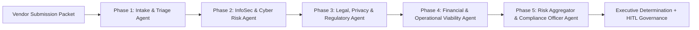

# Vendor Risk & Compliance Multi-Agent System

An autonomous **5-Phase Third-Party Risk Management (TPRM) & Vendor Onboarding** platform built with **Python, FastAPI, LangGraph StateGraph, and a Hybrid LLM / Compliance Engine** (`Google Gemini` / `OpenAI` + zero-dependency simulation fallback).

---

## Architecture & Multi-Agent Pipeline



### Specialized Agents

| Phase | Agent | Responsibilities & Tools |
| :--- | :--- | :--- |
| **Phase 1** | **Intake & Triage Agent** (`app/agents/intake_agent.py`) | Calculates inherent risk score (`0-100`), assigns criticality tier (`TIER_1_CRITICAL` to `TIER_4_LOW`), checks mandatory compliance documents, and determines fast-track eligibility (`classify_criticality_tier`). |
| **Phase 2** | **InfoSec & Cyber Risk Agent** (`app/agents/infosec_agent.py`) | Audits SOC 2 Type II & ISO 27001 certifications, exceptions, AES-256/TLS encryption, MFA/SSO enforcement, pentest CVEs, breach notification SLAs, and AI model training governance (`evaluate_infosec_controls`). |
| **Phase 3** | **Legal, Privacy & Regulatory Agent** (`app/agents/legal_agent.py`) | Screens global OFAC sanctions & adverse media watchlists, verifies GDPR/CCPA DPAs, EU/UK cross-border Standard Contractual Clauses (SCCs), MSA indemnification, and liability super-caps (`evaluate_legal_and_sanctions`). |
| **Phase 4** | **Financial & Operational Viability Agent** (`app/agents/financial_agent.py`) | Evaluates credit rating, liquidity runway, debt-to-equity leverage, annual BCP/DR failover testing, RTO/RPO recovery targets, and SLA uptime commitments (`evaluate_financial_and_ops`). |
| **Phase 5** | **Risk Aggregator & Compliance Officer Agent** (`app/agents/compliance_officer_agent.py`) | Computes weighted composite residual risk score, generates a prioritized **Remediation Action Plan**, drafts the **Executive Onboarding Memo**, and issues a determination (`APPROVED`, `APPROVED_WITH_CONDITIONS`, `ESCALATED_FOR_HUMAN_REVIEW`, or `REJECTED`). |

---

## Quick Start

### 1. Install Dependencies

```bash
cd vendor-risk-compliance
pip install -r requirements.txt
```

### 2. Configure LLM Mode (Optional)

The system runs **out-of-the-box** in hybrid mode (`EXECUTION_MODE=auto`):
- If `GEMINI_API_KEY` or `OPENAI_API_KEY` is set in `.env` or environment variables, agents use live LLM reasoning to synthesize findings.
- If no API key is set, it automatically falls back to the built-in deterministic compliance engine.

```bash
cp .env.example .env
# Optionally add GEMINI_API_KEY=... or OPENAI_API_KEY=...
```

### 3. Launch the Interactive Web Dashboard & API Server

```bash
uvicorn app.main:app --reload --port 8000
```

Open **[http://127.0.0.1:8000](http://127.0.0.1:8000)** in your browser to:
- Select from **4 realistic sample vendor onboarding packets** or create a custom vendor profile.
- Toggle security, privacy, sanctions, and financial controls in real time to run what-if simulations.
- Watch the **5 agents execute live via Server-Sent Events (SSE)** with tool telemetry and risk scoring.
- Perform **Human-in-the-Loop (HITL) Governance Sign-Off** overrides with audit logging.

### 4. Run via CLI

```bash
# Run a single preset vendor (e.g. CloudScale AI Inc.)
python3 cli.py --preset VND-1001

# Run all 4 sample vendor packets across all risk tiers
python3 cli.py --all
```

### 5. Run Tests

```bash
pytest -v
```
